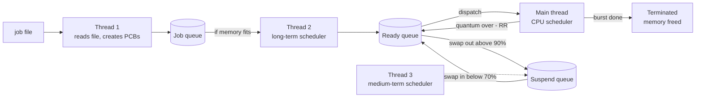

# Multithreaded CPU Scheduling Simulator

A Java simulator of how an operating system schedules processes. Four threads play the roles of the
OS schedulers and work in lock-step, one simulated millisecond at a time:
they load jobs into a 2048 MB memory, swap processes out when memory is full, and run them on a
single CPU with **SJF**, **Round Robin** or **Priority** scheduling (with starvation detection and aging).

It prints a Gantt chart, a per-process table and the average waiting and turnaround times.

## Features

- **Three CPU scheduling algorithms**: Shortest Job First, Round Robin (quantum = 5 ms) and
  non-preemptive Priority.
- **Starvation detection and aging**: a process that waits longer than `N × 5 ms` in the ready queue
  (N = ready-queue size) is marked as starved, and its priority is raised by one level every 4 ms.
- **Long-term scheduler** with a 2048 MB memory limit. Jobs are loaded in the same order the CPU
  scheduler uses (shortest first for SJF, highest priority first for Priority, FIFO for RR), and a
  lower job never takes the memory that a higher job is waiting for.
- **Medium-term scheduler** (optional): swaps a process out above 90% memory use and back in below 70%.
  It always swaps out the process the CPU would run last, so high-priority work is never pushed out.
- **Input validation**: wrong format, non-numbers, out-of-range values, duplicate or non-positive PIDs
  and jobs larger than memory are reported and skipped.
- **Deterministic results** on every run, thanks to semaphore-based turn-taking.
- **Automated tests**: scenario tests plus randomized tests that check invariants on hundreds of runs.

## Architecture



| Thread | Role |
|---|---|
| Thread 1 | Reads the job file, validates each line, creates a PCB and puts it in the job queue. |
| Thread 2 | Long-term scheduler: moves jobs from the job queue to the ready queue when memory allows. |
| Thread 3 | Medium-term scheduler: swaps ready processes out and in based on memory use. |
| Main | Short-term scheduler: runs the chosen algorithm and prints the results. |

### Synchronization

- **Turn-taking:** three semaphores that start at 0 pass control every millisecond:
  `main → Thread 2 → Thread 3 → main`. Only one thread touches the shared state at a time, so the
  results are the same on every run and no thread busy-waits.
- **Mutual exclusion:** a binary semaphore (`memoryMutex`) protects every critical section that reads
  or changes the job, ready and suspend queues or the used-memory counter.
- **`join()`:** the simulation starts only after Thread 1 has finished reading the file.

## Getting started

Requires **JDK 17 or newer**.

```sh
javac -d build/app src/*.java
java -cp build/app Main examples/job_team.txt
```

The program asks for the algorithm (`1` SJF, `2` RR, `3` Priority) and whether to enable the
medium-term scheduler (`y`/`n`). Without a file argument it reads `examples/job.txt`.

### Input format

One process per line:

```
PID:BurstTime:Priority;Memory
```

| Field | Rule |
|---|---|
| PID | positive and unique |
| BurstTime | ms, greater than 0 |
| Priority | 1 (highest) to 30 |
| Memory | MB, 1 to 2048 |

Example ([examples/job_team.txt](examples/job_team.txt)):

```
1:12:5;600
2:4:2;400
3:20:8;700
4:6:3;300
5:15:10;350
6:3:1;500
7:9:4;200
```

## Example output

Priority scheduling on `examples/job_team.txt`:

```
========== GANTT CHART ==========
| P6 | P2 | P4 | P7 | P1 | P3 | P5 |
0    3    7   13   22   34   54   69

========== PROCESS TABLE ==========
PID    Burst(ms)    Start(ms)    Terminate(ms)    Waiting(ms)    Turnaround(ms)
1      12           22           34               22             34
2      4            3            7                3              7
3      20           34           54               34             54
4      6            7            13               7              13
5      15           54           69               54             69
6      3            0            3                0              3
7      9            13           22               13             22

========== PERFORMANCE METRICS ==========
  Average Waiting Time:     19.00 ms
  Average Turnaround Time:  28.86 ms

========== STARVATION REPORT ==========
  P3 suffered starvation  (original priority: 8  ->  final priority: 7)
  P5 suffered starvation  (original priority: 10  ->  final priority: 5)
```

## Comparing the algorithms

Results on `examples/job_team.txt` (7 processes, 3050 MB in total, medium-term scheduler off):

| Algorithm | Avg. waiting time | Avg. turnaround time | Starved processes |
|---|---|---|---|
| SJF | **18.29 ms** | **28.14 ms** | – |
| Priority + aging | 19.00 ms | 28.86 ms | P3, P5 |
| Round Robin (q = 5 ms) | 36.57 ms | 46.43 ms | – |

- **SJF** gives the lowest average waiting time, as theory predicts.
- **Priority** comes close because the high-priority jobs in this file are also short.
  Aging guarantees that the low-priority jobs (P3, P5) still finish.
- **Round Robin** has the highest averages, because long jobs are cut into 5 ms slices.
  But it is the fairest: every process gets the CPU early and none can starve, which makes it
  the best choice for interactive systems.

## Tests

The tests run the real program in a separate JVM for each case and check its output.

```powershell
powershell -ExecutionPolicy Bypass -File tests\run_tests.ps1      # Windows
```

```sh
sh tests/run_tests.sh                                              # Linux / macOS
```

Add a number to also run randomized tests (for example `60` = 60 random job files × 3 algorithms × medium-term on/off).

What the tests cover:

- **Scenarios:** expected Gantt charts and averages computed by hand, tie-breaking, RR quantum
  boundaries, starvation thresholds, aging and its lower limit, memory limits and both
  admission and swap order.
- **Input:** invalid lines, a missing file, an empty file, invalid menu input and an Arabic system locale.
- **Random invariants:** the program always terminates, and every process finishes. The Gantt chart
  has no gaps or overlaps, each process runs for exactly its burst time, and `waiting = turnaround − burst`.
  Memory always stays between 0 and 2048 MB and ends at 0.

## Project structure

```
src/        Main, PCB, Scheduler, Thread1 (reader), Thread2 (long-term), Thread3 (medium-term)
examples/   sample job files
tests/      SimulatorTest + run scripts
```

## Background

Originally built as an Operating Systems course project, then extended with priority-aware
admission and swapping, full synchronization of the shared queues, and an automated test suite.
